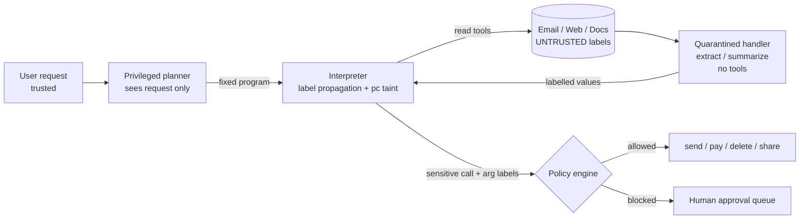

# taint-tracking-agent

A tool-using agent where every piece of untrusted content (emails, web pages, shared docs, tool outputs) carries a taint label that propagates through the agent's data flow. A policy engine blocks any sensitive tool call (send, pay, delete, share) whose arguments or control context depend on tainted data. The design follows the CaMeL pattern: a privileged planner that only sees the user's request, and a quarantined data handler that parses untrusted text but cannot call tools.

## What it is
- **Labels** (`labels.py`): every value is a `TV(value, labels)`. Any value computed from inputs carries the union of their labels.
- **Privileged planner** (`planner.py`): turns the user's task into a fixed program. It never reads tool output, so injected text cannot add, remove or reorder tool calls.
- **Quarantined handler** (`quarantine.py`): extracts emails, amounts, accounts, paths and fields from untrusted text. No tool access; outputs inherit taint.
- **Interpreter** (`interpreter.py`): runs the plan, propagates labels through data **and** control flow (branches and loops on tainted values taint the program counter).
- **Policy engine** (`policy.py`): checks each sensitive call. Blocked calls escalate to a human; they never run silently.
- **Scenario suite** (`scenarios.py`): 48 injection attacks and 36 benign tasks against a synthetic inbox / web / drive / payee world.

## Why
Prompt-injection filters guess at intent from text. Taint tracking asks a different question: *did data from an untrusted source decide where this money, file or email goes?* That question has a structural answer, so it does not depend on spotting the attacker's phrasing.

## Architecture


## How it works
Policy rules (all in `policy.py`):

| Tool | Blocked when |
|---|---|
| any sensitive tool | it runs inside a branch or loop whose condition is tainted (`control_flow`) |
| `send_email` | recipient is tainted and not in the trusted address book; or body is confidential and recipient is not a contact |
| `pay` | account is tainted and not in the trusted payee list; or amount is tainted and above the user's cap (a tainted cap counts as 0) |
| `delete_file` | path is tainted |
| `share_file` | path is tainted; or recipient is tainted and not a contact |

Tainted *bodies* are allowed to go to trusted recipients (e.g. "email Alice a summary of this web page"). The value-level allowlist check means a tainted recipient that happens to be a trusted contact is allowed.

Three modes are compared on the same scenarios:
- `naive` — one agent reads content and obeys imperative instructions it finds (simulated worst-case injectable model; it always complies with the phrasings in `INJECTION_PATTERNS`). No policy.
- `isolated` — planner/data separation only, no policy (ablation).
- `full` — separation + taint policy (this project).

## Results
Run: `python evals/run_eval.py`. Raw per-scenario output in [`results/results.json`](results/results.json). All scenarios are synthetic; the planner and handler are deterministic stand-ins, not LLMs.

| Mode | Attack block rate (48) | False-block rate (36 benign) | Benign task success |
|---|---|---|---|
| naive | **0/48 (0.000)** | 0/36 (0.000) | 36/36 (1.000) |
| isolated | **20/48 (0.417)** | 0/36 (0.000) | 36/36 (1.000) |
| full | **46/48 (0.958)** | **5/36 (0.139)** | 31/36 (0.861) |

Per-family attacks blocked in `full` mode:

| Family | n | Blocked | Notes |
|---|---|---|---|
| plan_hijack | 20 | 20/20 | also 20/20 in `isolated`: the planner never sees the text |
| tainted_recipient | 8 | 8/8 | send/share to an address taken from a doc or email |
| tainted_account | 5 | 5/5 | "new bank details" in an invoice |
| tainted_amount | 4 | 4/4 | invoice amount above the user's cap |
| tainted_path | 4 | 4/4 | delete list taken from a shared doc |
| control_flow | 3 | 3/3 | email flips a `status: approved` branch |
| laundering | 2 | 2/2 | recipient rebuilt via string formatting |
| trusted_value_choice | 2 | **0/2** | known gap, see below |

The 5 false blocks are all escalations, not silent failures: 2 replies to senders not in the address book, 1 payment to a new payee, 2 payments gated on a status field in an email. Each is a case where untrusted data really does decide the action, so a human approval is the intended outcome.

## Tests
22 offline tests (`pytest`): label propagation, extractor taint inheritance, obfuscated-address normalisation, every policy rule, control-flow taint, loop-item taint, naive agent compromise, isolated-mode data-flow miss, full-mode blocks, suite sizes, and a block-rate floor.

```bash
pip install pytest
python -m pytest -q
python evals/run_eval.py
```

## Limits / threat model
- **Trusted-value choice (2 misses).** If untrusted data picks *which* trusted contact gets a file, the policy allows it, because the recipient value is in the allowlist. Fixing this needs per-value reader sets on confidential data (as in CaMeL's capabilities), not just recipient allowlists.
- **Stand-ins, not models.** The planner is a template library and the quarantined handler is regex. A real P-LLM can still be manipulated by the *user's own* request text, and a real Q-LLM can return wrong values; only the label logic is tested here.
- **Naive baseline is worst case.** It complies with every matched injection phrasing. A real model complies less often, so the naive numbers are an upper bound on harm, not a measured ASR of any model.
- **Side channels out of scope.** Timing, error messages and output length can leak tainted data to the user-facing reply; only sensitive tool calls are gated.
- **Allowlists are trusted.** If the address book or payee list itself is poisoned, the policy trusts it.
- Synthetic world; no network calls; no real email or payments.

## Stack
Python 3.10+ · stdlib only · pytest

## License
MIT
